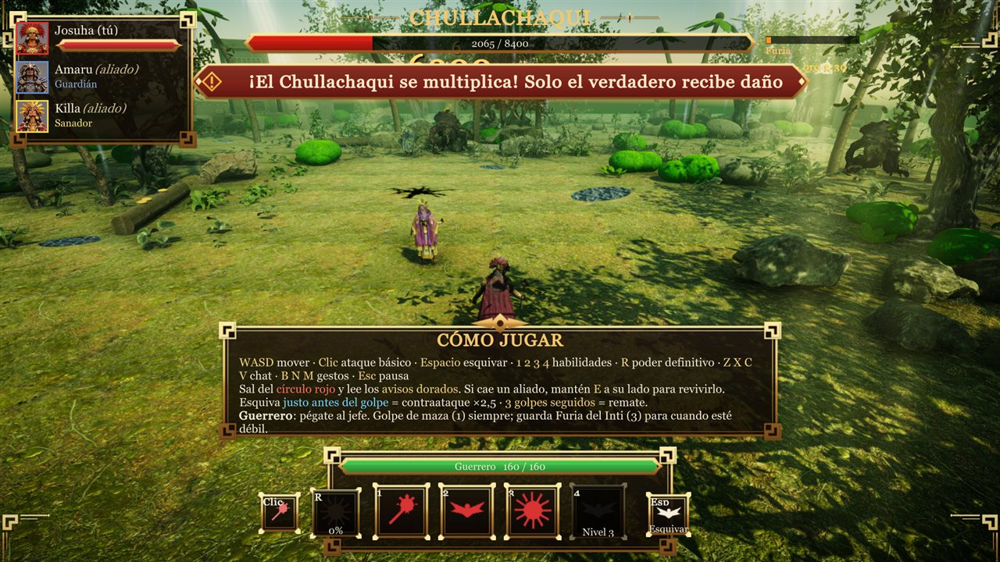
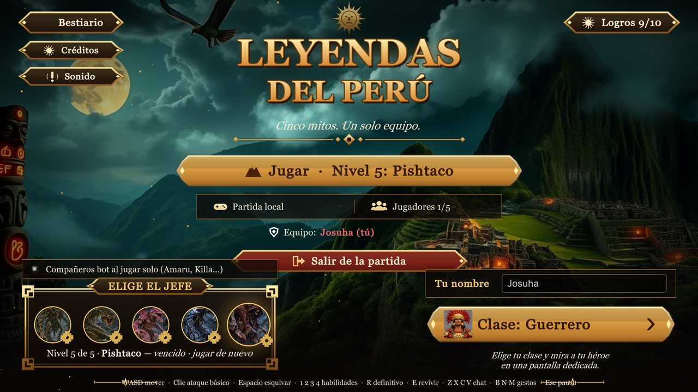
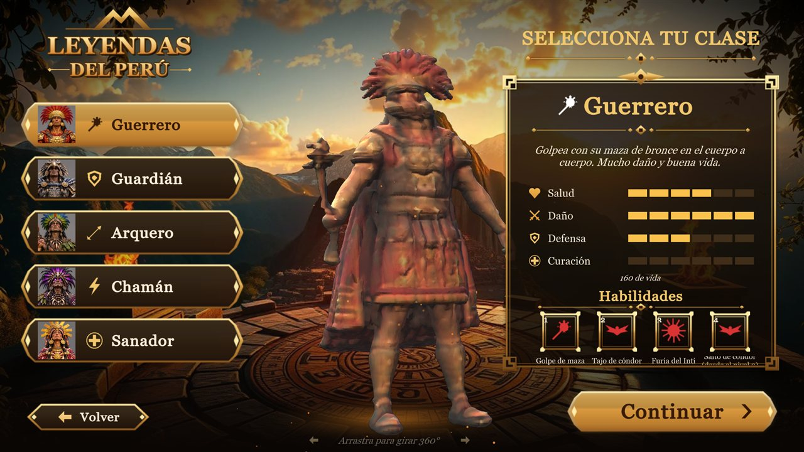
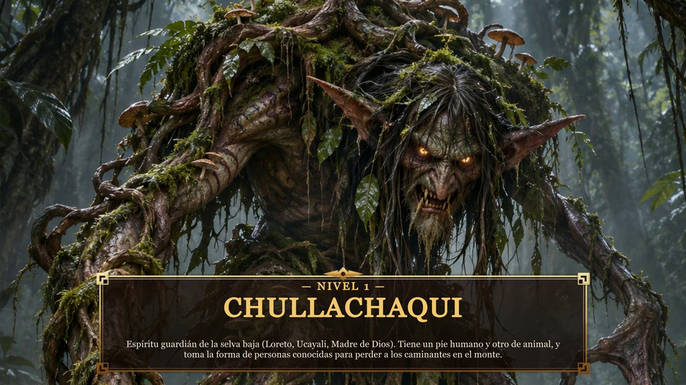
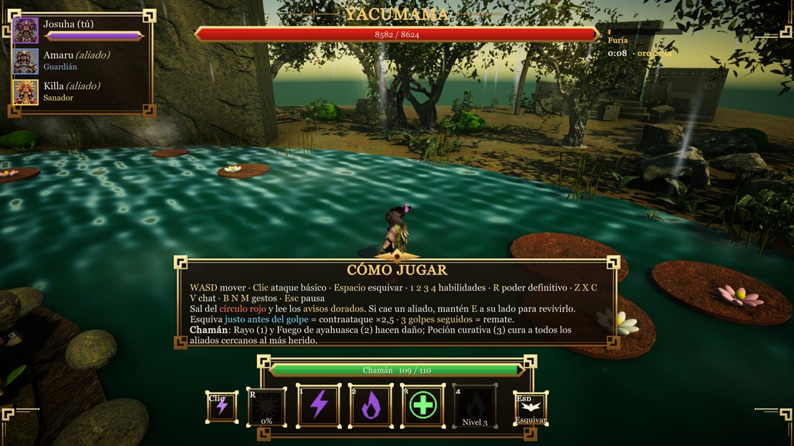
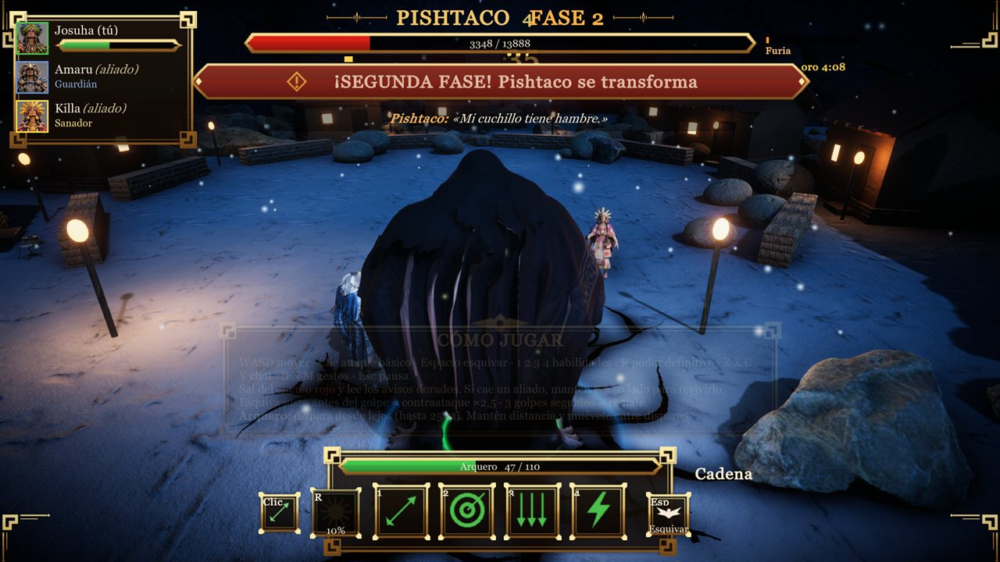
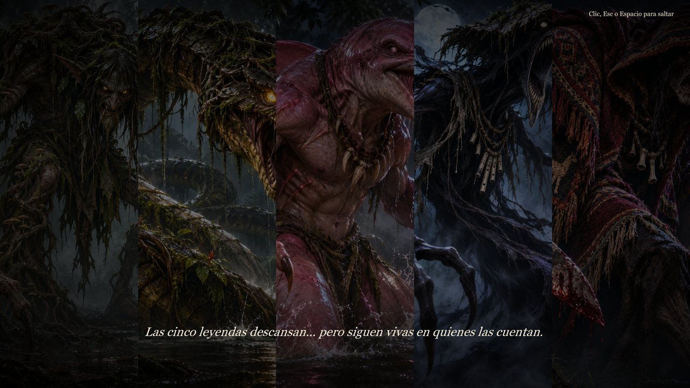

<h1 align="center">🗿 Leyendas del Perú</h1>

  Online co-op boss-raid game for up to 5 players, inspired by Peruvian legends. Made with Unity 6 and C#. 
  <em>Juego cooperativo de jefes en línea para hasta 5 jugadores, inspirado en leyendas peruanas. Hecho en Unity 6 y C#.</em>

  

  
  
  
  

  

  <a href="#español">Español</a> · <a href="#english">English</a>

---

## Español

### El juego

Un equipo de héroes andinos enfrenta, nivel por nivel, a cinco criaturas de la tradición oral peruana, de la selva amazónica a los Andes. Se juega **en línea con amigos** (código de 6 letras, sin abrir puertos), **en la misma red Wi-Fi** o **solo con compañeros bot**.

| Nivel | Jefe | Escenario |
|---|---|---|
| 1 | **Chullachaqui** | Selva amazónica |
| 2 | **Yacumama** | Isla pequeña en una laguna; la serpiente nada en círculos alrededor |
| 3 | **Bufeo Colorado** | Pueblo ribereño de noche |
| 4 | **Tunche** | Bosque nocturno con círculo de velas |
| 5 | **Pishtaco** (jefe final) | Pueblo andino; segunda fase y furia final |

| Clase | Rol |
|---|---|
| Guerrero | Daño cuerpo a cuerpo |
| Guardián | Tanque: atrae al jefe y protege al grupo |
| Arquero | Daño a distancia |
| Chamán | Daño mágico + poción curativa en área |
| Sanador | Curación y apoyo |

### Capturas

| | |
|---|---|
|  |  |
|  |  |
|  |  |

### Cómo jugar

1. Descarga el `.zip` desde **[Releases](https://github.com/JosuhaAML/leyendas-del-peru/releases/latest)** y descomprímelo.
2. Abre `Leyendas del Peru/LeyendasDelPeru.exe` (no requiere instalación). Si Windows muestra *"Windows protegió su PC"*: **Más información → Ejecutar de todas formas**.
3. **Solo:** *Crear red local → Jugar* (te acompañan bots). **En línea:** uno pulsa *Crear partida en línea* y comparte el código; los demás lo escriben y pulsan *Unirse con código*.

**Controles:** WASD mover · Clic ataque básico · Clic derecho girar cámara · Espacio esquivar · 1 2 3 4 habilidades · R poder definitivo · E revivir aliado · Z X C V chat rápido · B N M gestos · Esc pausa · F11 pantalla completa

**Requisitos:** Windows 10/11 de 64 bits; tarjeta gráfica dedicada recomendada.

### Lo técnico (dónde mirar el código)

- **Multijugador en línea**: Netcode for GameObjects + **Unity Relay** para jugar por internet sin abrir puertos. RPCs y `NetworkVariable` para sincronizar vida, habilidades, gestos y chat rápido.
  → [`NetworkUI.cs`](Assets/Scripts/Game/NetworkUI.cs), [`PlayerAbilities.cs`](Assets/Scripts/Player/PlayerAbilities.cs)
- **IA de jefes** como máquina de estados con más de 25 ataques (avisos en el suelo, combos, fases y furia), repartida en clases `partial`.
  → [`BossAI.cs`](Assets/Scripts/Boss/BossAI.cs), [`BossAIFinal.cs`](Assets/Scripts/Boss/BossAIFinal.cs), [`BossAIYacumama.cs`](Assets/Scripts/Boss/BossAIYacumama.cs), [`BossAIExtras.cs`](Assets/Scripts/Boss/BossAIExtras.cs)
- **Dificultad que escala con el equipo**: la vida del jefe se ajusta según el número de jugadores, balanceada midiendo el daño por segundo real de cada grupo.
- **Animación procedural** de los héroes (correr, atacar, esquivar, saludar, bailar), hecha por código.
  → [`HeroRig.cs`](Assets/Scripts/Player/HeroRig.cs), [`HeroMotion.cs`](Assets/Scripts/Player/HeroMotion.cs)
- **Bots aliados y piloto automático** para jugar solo y para pruebas.
  → [`BotAlly.cs`](Assets/Scripts/Player/BotAlly.cs), [`AutoPilot.cs`](Assets/Scripts/Game/AutoPilot.cs)
- **Pruebas automáticas**: el ejecutable acepta argumentos (`-autotest`, `-campana`, `-animtest`…) que juegan solos, toman capturas y escriben resultados en el log. Las capturas de este README se generaron así.
  → [`AutoTest.cs`](Assets/Scripts/Game/AutoTest.cs)
- **Proyecto generado por código**: escenas, niveles, jefes, prefabs y el build se crean desde scripts de editor (menú **Leyendas → Generar proyecto**).
  → [`GameSetup.cs`](Assets/Editor/GameSetup.cs), [`BuildGame.cs`](Assets/Editor/BuildGame.cs)
- **Interfaz** IMGUI con estilo propio: HUD, menú, selección de clase, bestiario, logros, epílogo y créditos.
  → [`HUD.cs`](Assets/Scripts/Game/HUD.cs), [`UIStyle.cs`](Assets/Scripts/Game/UIStyle.cs), [`Bestiario.cs`](Assets/Scripts/Game/Bestiario.cs)

Unas **13 400 líneas de C#** en 59 scripts.

### Abrir el proyecto en Unity

1. Instala **Unity 6000.6.6f1** desde Unity Hub.
2. Unity Hub → **Add → Add project from disk** → elige esta carpeta.
3. Abre la escena `Assets/Juego/Escenas/Menu` y pulsa **Play**.
4. Para probar varios jugadores en una sola PC: **Window → Multiplayer → Multiplayer Play Mode**.

---

## English

### The game

A party of Andean heroes faces five creatures from Peruvian folklore, from the Amazon rainforest to the Andes. Play **online with friends** (6-letter join code, no port forwarding), on the **same Wi-Fi**, or **solo with bot allies**. Five bosses with phases and enrage mechanics, five classes (Warrior, Guardian, Archer, Shaman, Healer).

### Technical highlights

- **Online multiplayer** with Netcode for GameObjects and **Unity Relay**; state synced with RPCs and `NetworkVariable`s.
- **Boss AI** as a state machine with 25+ attacks, telegraphs, combos, phases and enrage.
- **Difficulty scaling** by party size, tuned from measured DPS.
- **Procedural hero animation** written in code, **bot allies** and an **autopilot**.
- **Automated play tests** via command-line flags that play the game, take screenshots and log results (the screenshots above were generated this way).
- **Code-generated project**: scenes, levels, bosses, prefabs and builds are created from editor scripts.

About **13,400 lines of C#** across 59 scripts. Download the Windows build from **[Releases](https://github.com/JosuhaAML/leyendas-del-peru/releases/latest)**.

---

## Créditos / Credits

**Desarrollado por / Developed by:** Michael Josuha Alanya Masgo

- Árboles, rocas, plantas, objetos y texturas: [Poly Haven](https://polyhaven.com) (CC0)
- Animaciones de personajes: [Mixamo](https://www.mixamo.com)
- Modelos 3D generados con IA: TRELLIS y TripoSR
- Voces del narrador y de los jefes: XTTS-v2
- Música y efectos de sonido: generados por código · Canción de créditos: «Camino largo», anticuchostudios
- Programación y diseño con ayuda de Claude (Anthropic)

## Licencia / License

El **código fuente** (`Assets/Scripts`, `Assets/Editor`) se publica bajo la [licencia MIT](LICENSE). Los recursos de terceros (modelos, animaciones, audio) conservan sus propias licencias.

The **source code** is released under the [MIT License](LICENSE). Third-party assets keep their own licenses.
